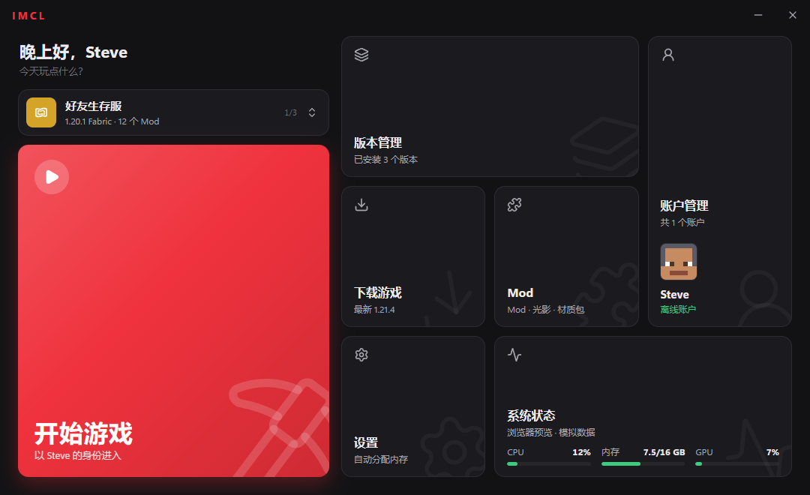
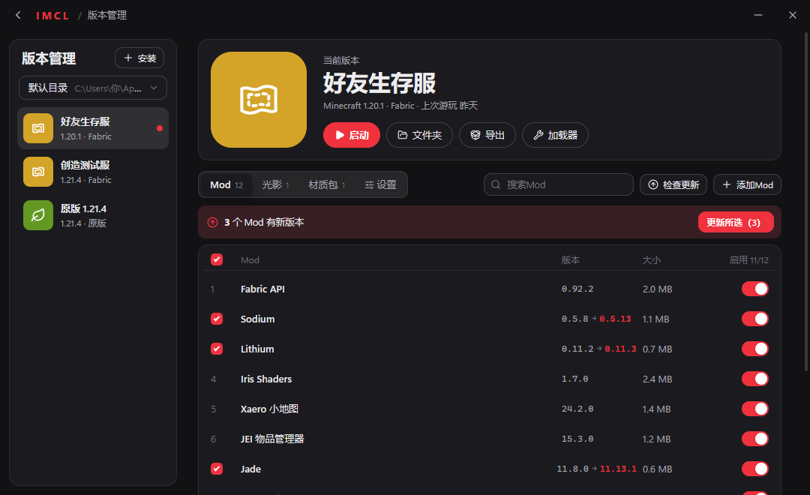
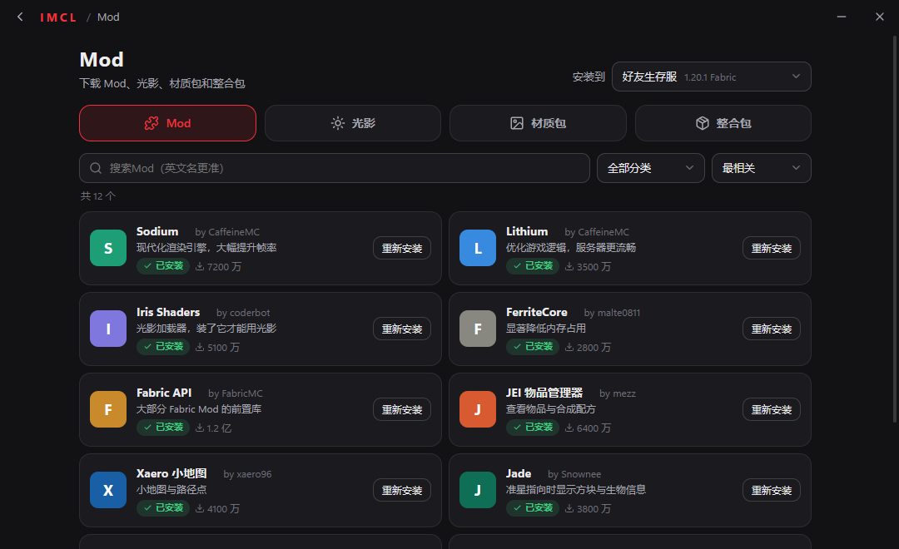
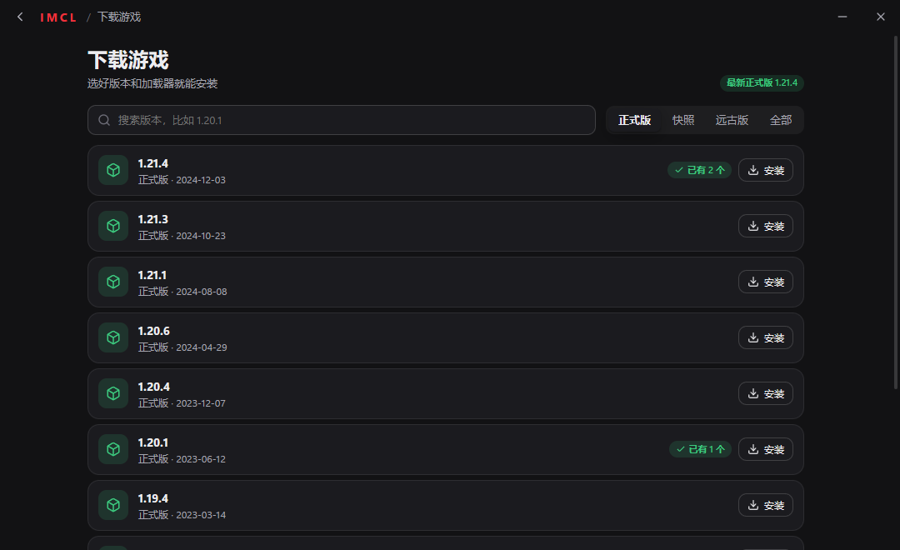
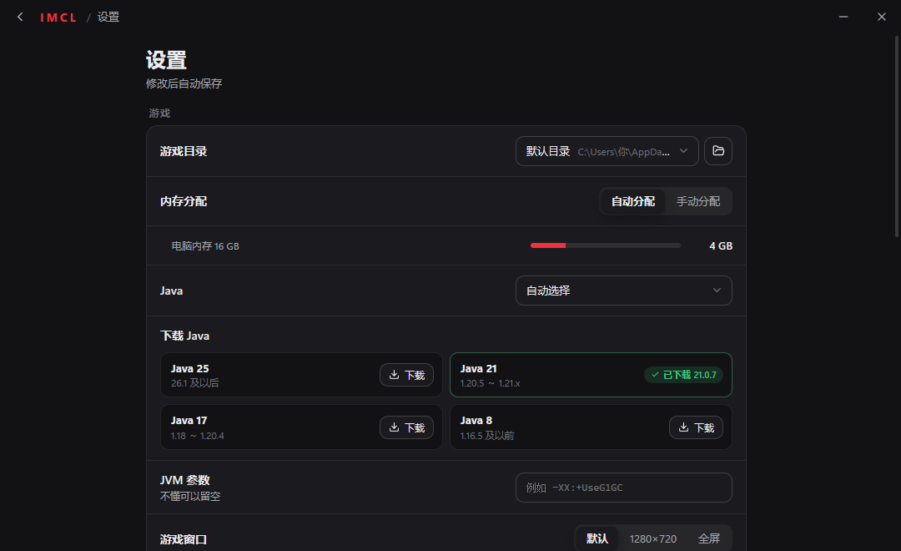

<div align="center">


# IMCL

一个轻量的 Minecraft Java 版启动器，用 Tauri + Rust + Svelte 写成。

安装包只有 2 MB 左右，界面是卡片风格，支持云母材质和自定义背景。

</div>



## 功能

**游戏**

- 下载安装任意版本（正式版、快照、远古版），可以同时装 Fabric、Quilt、Forge、NeoForge 和 OptiFine
- 版本隔离：每个版本的 Mod、存档、配置分开存放，也可以和其他版本共用
- 每个版本可以单独设置 Java、内存、启动账户、游戏窗口和 JVM 参数
- 在版本管理里直接更换加载器或加载器版本
- 自动查找本机的 Java，没有合适的会自动下载（官方源和镜像源测速后选快的那个）
- 内存自动分配：按 Mod 数量决定给多少；也可以手动分配
- 可以添加其他启动器的游戏文件夹（.minecraft），直接用里面的版本

**Mod、光影、材质包、整合包**

- 从 Modrinth 搜索下载，可以选具体版本，自动安装前置 Mod
- Mod 一键检查更新、批量更新，单独启用或禁用
- 安装 Modrinth 整合包，从本地 `.mrpack` 导入
- 把一个版本导出成 `.mrpack` 整合包，发给朋友就能装上一样的 Mod

**账户**

- 离线账户：可以选 Steve、Alex 或自定义皮肤，进游戏后自己和别人都能看到皮肤
  （启动器在本机临时运行一个皮肤服务，配合 authlib-injector 实现）
- 微软正版登录（需要自己注册 Azure 应用，见下文）

**外观**

- 亮色、暗色、跟随系统；主题色可选
- 背景材质：实色或 Windows 11 云母，实色可以设置背景图片
- 卡片材质：自定义不透明度和模糊，或者直接用云母

## 截图

| 版本管理 | Mod 下载 |
| --- | --- |
|  |  |
| **下载游戏** | **设置** |
|  |  |

## 下载

到 [Releases](../../releases) 下载最新的 `IMCL_x.x.x_x64-setup.exe`，双击安装即可。

系统要求：Windows 10 / 11（64 位）。云母材质需要 Windows 11。

## 从源码构建

需要先装好：

- [Node.js](https://nodejs.org/) 20 或更新
- [Rust](https://www.rust-lang.org/tools/install)（stable）
- [Tauri 的系统依赖](https://v2.tauri.app/start/prerequisites/)（Windows 上是 Microsoft C++ 生成工具和 WebView2）

```bash
npm install
npm run tauri dev     # 开发模式，改代码会自动刷新
npm run tauri build   # 打包安装程序，输出在 src-tauri/target/release/bundle/nsis/
```

Windows 上也可以直接双击 `dev.bat` 启动开发模式。

只想看界面的话，`npm run dev` 会在浏览器里打开预览，用的是演示数据。

## 微软正版登录

微软登录要用你自己注册的 Azure 应用（Client ID），步骤大致是：

1. 在 [Azure 门户](https://portal.azure.com) 的 Microsoft Entra ID 里注册一个应用，
   帐户类型选择包含“个人 Microsoft 帐户”的选项，重定向 URI 留空
2. 在应用的“身份验证”里打开“允许公共客户端流”
3. 通过 [aka.ms/mce-reviewappid](https://aka.ms/mce-reviewappid) 申请调用 Minecraft 接口的权限，等待审核
4. 把“应用程序(客户端) ID”填到启动器的账户页

审核通过之前，登录会在最后一步失败（403）。

## 项目结构

```
src/                 前端（SvelteKit + Svelte 5）
  lib/pages/         各个页面
  lib/components/    通用组件
  lib/state.svelte.ts  全局状态和设置
src-tauri/src/       后端（Rust）
  game/              版本解析、安装、启动
  modrinth.rs        Mod 搜索、下载、更新
  modpack*.rs        整合包安装和导出
  auth.rs            微软登录
  ygg.rs             离线皮肤用的本地 Yggdrasil 服务
  jre.rs / java.rs   Java 下载和查找
  backdrop.rs        Windows 11 云母
```

## 致谢

- [BMCLAPI](https://bmclapi2.bangbang93.com/)：游戏文件、加载器和 Java 下载镜像
- [MCIM](https://github.com/mcmod-info-mirror)：Modrinth 镜像
- [Modrinth](https://modrinth.com/)：Mod、光影、材质包和整合包
- [authlib-injector](https://github.com/yushijinhun/authlib-injector)：离线账户的皮肤显示
- [Tauri](https://tauri.app/)、[Svelte](https://svelte.dev/)、[Lucide](https://lucide.dev/)

## 声明

本项目与 Mojang Studios、Microsoft 没有任何关联。Minecraft 是 Mojang Synergies AB 的商标。

## 许可证

[MIT](LICENSE)
